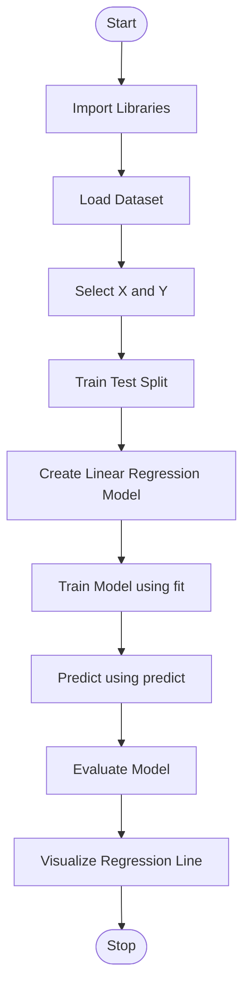

# Linear-Regression
Implementation of Simple Linear Regression using Python and Scikit-learn to predict continuous values

readme_content = """# Simple Linear Regression

## 1. Introduction

Simple Linear Regression is a Supervised Machine Learning algorithm
used to predict continuous numerical values.

It establishes a linear relationship between one independent variable (X)
and one dependent variable (Y).

The algorithm finds the best-fit straight line through the data points
and uses it to make predictions.

## 2. Theory

Simple Linear Regression works by identifying how changes in the
independent variable affect the dependent variable.

It uses the Least Squares Method to find the best-fit line by
minimizing the sum of squared errors between actual and predicted values.

### Mathematical Equation

    Y = mX + c

Where:

- X = Independent Variable
- Y = Dependent Variable
- m = Slope of the line
- c = Y-intercept

### Cost Function

    MSE = (1/n) * Σ(Y_actual - Y_predicted)^2

The objective is to minimize Mean Squared Error (MSE).

## 3. Algorithm

1. Start
2. Import required libraries.
3. Load the dataset.
4. Select independent variable (X).
5. Select dependent variable (Y).
6. Split the dataset into training and testing sets.
7. Create the Linear Regression model.
8. Train the model using fit().
9. Predict values using predict().
10. Evaluate the model using performance metrics.
11. Visualize the regression line.
12. Stop.

## 4. Flowchart

## 5. Important Keywords

| Keyword | Description |
|---|---|
| Supervised Learning | Learning using labelled data |
| Regression | Predicting continuous numerical values |
| Independent Variable | Input feature (X) |
| Dependent Variable | Target variable (Y) |
| Slope | Rate of change in Y with respect to X |
| Intercept | Value of Y when X is zero |
| Best Fit Line | Line representing the linear relationship |
| Residual | Difference between actual and predicted values |
| MSE | Mean Squared Error |
| R2 Score | Measures how well the model explains data variation |
| fit() | Trains the model |
| predict() | Generates predictions |

## 6. Important Libraries

- Pandas: Dataset loading and manipulation.
- NumPy: Numerical calculations.
- Matplotlib: Data visualization.
- Scikit-learn: Model training, testing and evaluation.

## 7. Advantages

- Simple and easy to understand.
- Easy to implement.
- Computationally efficient.
- Useful for identifying linear relationships.

## 8. Limitations

- Works best when the relationship is approximately linear.
- Sensitive to outliers.
- Uses only one independent variable.
- May perform poorly on complex nonlinear datasets.

## 9. Applications

- House price prediction.
- Salary prediction.
- Sales forecasting.
- Student performance prediction.
- Trend analysis.

## 10. Conclusion

Simple Linear Regression is a fundamental supervised machine learning
algorithm that predicts continuous values by finding the best-fit
straight line between two variables.
"""

